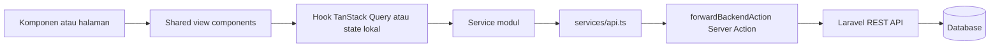

# Sistem Pelacakan Pergerakan Satwa Liar — Frontend

README terpadu untuk repository `wildlife-tracking-frontend`. Dokumen ini menjadi satu-satunya sumber dokumentasi frontend: arsitektur, komponen, konvensi UI/UX, integrasi API, autentikasi, lingkungan pengembangan, pengujian, serta batasan yang diketahui.

Frontend ini adalah klien web Next.js App Router untuk **Balai Taman Nasional Gunung Leuser (BTNGL)**. Frontend mengelola antarmuka dan alur interaksi; data, validasi akhir, autentikasi, otorisasi, dan logika bisnis berada di backend Laravel pada repository `wildlife-tracking-backend`.

## Daftar isi

- [1. Ringkasan proyek](#1-ringkasan-proyek)
- [2. Tumpukan teknologi](#2-tumpukan-teknologi)
- [3. Arsitektur sistem](#3-arsitektur-sistem)
- [4. Struktur proyek](#4-struktur-proyek)
- [5. Routing dan modul utama](#5-routing-dan-modul-utama)
- [6. Komponen yang dapat digunakan kembali](#6-komponen-yang-dapat-digunakan-kembali)
- [7. Panduan UI/UX dan desain responsif](#7-panduan-uiux-dan-desain-responsif)
- [8. Hook, layanan, dan integrasi API](#8-hook-layanan-dan-integrasi-api)
- [9. Autentikasi dan otorisasi](#9-autentikasi-dan-otorisasi)
- [10. Instalasi dan konfigurasi lingkungan](#10-instalasi-dan-konfigurasi-lingkungan)
- [11. Alur kerja dan konvensi pengembangan](#11-alur-kerja-dan-konvensi-pengembangan)
- [12. Pengujian dan validasi](#12-pengujian-dan-validasi)
- [13. Keterbatasan dan peningkatan lanjutan](#13-keterbatasan-dan-peningkatan-lanjutan)
- [14. Panduan tim dan referensi](#14-panduan-tim-dan-referensi)

## 1. Ringkasan proyek

Sistem ini membantu pemantauan satwa liar di ekosistem Gunung Leuser melalui data satwa, spesies, perangkat GPS, pembacaan posisi, zona geografis, insiden lapangan, notifikasi, dan laporan. Frontend menyajikan alur kerja tersebut dalam antarmuka web yang responsif dan terhubung ke API Laravel.

| Modul | Tujuan utama | Status pada kode saat ini |
| --- | --- | --- |
| Login dan sesi | Masuk dengan email dan kata sandi, menyimpan sesi httpOnly | Terimplementasi; memiliki keterbatasan yang tercantum di bagian 9 |
| Dashboard | Ringkasan satwa, perangkat, insiden, dan prediksi AI | Terhubung ke API; agregasi dilakukan di klien |
| Satwa | Daftar, detail, pencarian, filter, tambah, ubah, hapus | Terimplementasi melalui list view, detail view, dan modal form |
| Spesies | Daftar, detail, pencarian, filter, tambah, ubah, hapus | Terimplementasi dengan pola yang sama dengan satwa |
| Perangkat | Daftar, detail, kondisi perangkat, tambah, ubah, hapus | Terimplementasi dengan pola yang sama dengan satwa |
| Zona geografis | Daftar zona, data peta, tambah, ubah, hapus | Terimplementasi; list view masih memakai tabel lokal |
| Insiden | Daftar dan pembuatan laporan insiden lapangan | Terimplementasi |
| Notifikasi | Daftar notifikasi dan penandaan sebagai dibaca | Terimplementasi |
| Peta langsung | Visualisasi posisi satwa dan zona dengan Leaflet | Terimplementasi |
| Statistik | Ringkasan numerik dan grafik berdasarkan data API | Terhubung ke hook data; bukan angka statis pada kode saat ini |
| Wildlife Explorer | Eksplorasi satwa | Placeholder antarmuka |
| Prediksi AI | Verifikasi prediksi spesies | Endpoint terdaftar, belum ada UI khusus |

Hubungan antarrepository:

| Repository | Peran |
| --- | --- |
| `wildlife-tracking-frontend` | Antarmuka web, state klien, dan komunikasi dengan API |
| `wildlife-tracking-backend` | REST API, Sanctum, validasi, Eloquent, aturan bisnis, dan modul AI |
| `wildlife-tracking-database` | Dokumentasi ERD, kamus data, dan rancangan skema |

Port pengembangan: frontend `3000`, backend `8000`, dan MySQL `3306` bila dipakai. Secara default backend dapat berjalan dengan SQLite; konfigurasi database final berada di repository backend.

## 2. Tumpukan teknologi

Versi berikut berasal dari `package.json`. Tanda `^` berarti rentang versi yang diizinkan npm.

| Kategori | Paket | Versi | Penggunaan |
| --- | --- | --- | --- |
| Framework | `next` | `16.3.8` | App Router, Server Actions, build produksi |
| UI | `react`, `react-dom` | `19.2.8` | Render antarmuka |
| Bahasa | `typescript` | `^5` | `strict: true` melalui `tsconfig.json` |
| Styling | `tailwindcss`, `@tailwindcss/postcss` | `^4` | CSS-first Tailwind 4 di `app/globals.css` |
| Data async | `@tanstack/react-query` | `^5.104.4` | Query, mutasi, cache, invalidasi |
| Tabel | `@tanstack/react-table` | `^8.21.3` | Sorting, filtering, pagination klien |
| Form | `react-hook-form`, `@hookform/resolvers` | `^7.90.0`, `^5.9.2` | Form login dan validasi Zod |
| Validasi | `zod` | `^4.6.5` | Skema validasi sisi klien |
| Peta | `leaflet`, `@types/leaflet` | `^1.9.4`, `^1.9.22` | Peta langsung dan zona |
| Ikon | `lucide-react` | `^1.60.0` | Ikon antarmuka |
| Utilitas kelas | `clsx`, `tailwind-merge` | `^2.1.1`, `^3.7.0` | Penggabungan kelas melalui `cn()` |
| Lint | `eslint`, `eslint-config-next` | `^9`, `16.3.8` | `core-web-vitals` dan aturan TypeScript Next.js |

Tidak ada Axios. Seluruh HTTP browser melewati satu `fetch` di `services/api.ts`. Belum ada runner test, dan tidak ada script `typecheck`; pemeriksaan tipe dijalankan dengan `npx tsc --noEmit`.

## 3. Arsitektur sistem

Alur data yang berlaku:



Prinsip utama:

- `app/` hanya routing. Tidak ada `app/api/`, route handler, atau logika bisnis di dalam direktori tersebut.
- Satu-satunya file `"use server"` adalah `services/backend-actions.ts`. File ini menjadi batas server untuk membaca cookie dan meneruskan request ke backend.
- `services/api.ts` adalah satu-satunya API client. File ini menangani base URL, header standar, query string, timeout 10 detik, `ApiError`, parsing respons, `fetch`, dan response `204 No Content`.
- Service modul menulis path resource relatif terhadap base URL Laravel `/api` dan memanggil method di `services/api.ts`.
- Komponen tidak pernah memanggil `fetch` atau API langsung.
- Backend belum menyediakan pagination server. Service menyintesis `meta` secara lokal agar bentuk data konsumen tetap stabil.
- Cookie `wms_session` dan `wms_token` berupa httpOnly. Token bearer hanya ditambahkan di server.

Perubahan konfigurasi atau penambahan endpoint harus mengikuti alur ini. Jangan memperkenalkan proxy baru, route handler baru, atau lapisan mock di dalam komponen.

## 4. Struktur proyek

Struktur aktual root frontend:

```text
wildlife-tracking-frontend/
├── app/
│   ├── layout.tsx
│   ├── globals.css
│   ├── page.tsx
│   ├── login/
│   │   └── page.tsx
│   └── (protected)/
│       ├── layout.tsx
│       ├── dashboard/
│       ├── animals/
│       ├── species/
│       ├── devices/
│       ├── geo-zones/
│       ├── incidents/
│       ├── notifications/
│       ├── tracking/live-map/
│       ├── statistics/
│       └── wildlife-explorer/
├── components/
│   ├── auth/
│   ├── layout/
│   ├── providers/
│   ├── shared/
│   │   ├── animals/
│   │   ├── dashboard/
│   │   ├── devices/
│   │   ├── geo-zones/
│   │   ├── incidents/
│   │   ├── notifications/
│   │   ├── species/
│   │   └── tracking/
│   └── ui/
├── hooks/
├── lib/
├── public/
│   └── images/
├── services/
├── types/
├── utils/
├── .env.example
├── eslint.config.mjs
├── next.config.ts
├── next-env.d.ts
├── package.json
├── package-lock.json
├── postcss.config.mjs
└── tsconfig.json
```

Fungsi direktori:

| Direktori | Isi dan batas |
| --- | --- |
| `app/` | Halaman dan layout Next.js. Page sebaiknya tipis dan hanya merakit hook serta shared component. |
| `components/ui/` | Primitif antarmuka generik: tombol, form, panel, dialog, tabel, filter, state, badge, statistik, breadcrumb. |
| `components/shared/<domain>/` | View, list, detail, dan form spesifik domain. Komponen di sini boleh mengetahui bentuk data domain. |
| `components/layout/` | `AppShell`, `Header`, `Sidebar`, `MobileNav`, dan `NavIcon`. |
| `components/providers/` | `QueryClientProvider` dan `ToastProvider`. |
| `components/auth/` | Form login dan komponen terkait autentikasi. |
| `hooks/` | Semua custom hook, datar, dengan awalan `use-`. |
| `services/` | HTTP client, Server Action, registry endpoint, cookie, konfigurasi server, dan service per domain. |
| `types/` | Semua tipe TypeScript, datar, dengan akhiran `.type.ts`. |
| `lib/` | Infrastruktur lintas modul: sesi, navigasi, nama cookie, dan utilitas kelas. |
| `utils/` | Fungsi murni kecil seperti formatter. |
| `public/` | Aset statis, termasuk logo BTNGL. |

Alias `@/*` menunjuk ke root frontend melalui `tsconfig.json`. Tidak ada direktori `src/`, `features/`, `schemas/`, atau `constants/`. Semua folder berada langsung di root repository.

File baru ditempatkan sebagai berikut:

| Kebutuhan | Lokasi |
| --- | --- |
| Halaman baru | `app/(protected)/<modul>/page.tsx` |
| Tampilan domain baru | `components/shared/<modul>/` |
| Komponen generik baru | `components/ui/` |
| Hook pengambilan data baru | `hooks/use-<modul>.ts` |
| Service API baru | `services/<modul>.service.ts` |
| Tipe baru | `types/<modul>.type.ts` |
| Entri menu | `lib/navigation.ts` |
| Permintaan API baru | `api.get`/`api.post` di service modul; path relatif terhadap `/api` |

Rute legacy `/master-data/animals`, `/master-data/species`, `/master-data/devices`, dan `/master-data/geo-zones` tetap berfungsi melalui rewrite di `next.config.ts` ke rute tanpa prefiks `/master-data`.

## 5. Routing dan modul utama

Grup `(protected)` tidak memengaruhi URL. Layout grup memeriksa cookie sesi dan mengalihkan ke `/login` bila sesi tidak ada.

| Rute | File halaman | Fungsi |
| --- | --- | --- |
| `/` | `app/page.tsx` | Alihkan ke `/dashboard` atau `/login` sesuai sesi |
| `/login` | `app/login/page.tsx` | Form masuk |
| `/dashboard` | `app/(protected)/dashboard/page.tsx` | Ringkasan operasional |
| `/animals` | `app/(protected)/animals/page.tsx` | Daftar satwa |
| `/animals/create` | `app/(protected)/animals/create/page.tsx` | Tambah satwa |
| `/animals/[id]/detail` | `app/(protected)/animals/[id]/detail/page.tsx` | Detail satwa dan riwayat terkait |
| `/animals/[id]/update` | `app/(protected)/animals/[id]/update/page.tsx` | Ubah satwa |
| `/species` | `app/(protected)/species/page.tsx` | Daftar spesies |
| `/species/create` | `app/(protected)/species/create/page.tsx` | Tambah spesies |
| `/species/[id]/detail` | `app/(protected)/species/[id]/detail/page.tsx` | Detail spesies |
| `/species/[id]/update` | `app/(protected)/species/[id]/update/page.tsx` | Ubah spesies |
| `/devices` | `app/(protected)/devices/page.tsx` | Daftar perangkat GPS |
| `/devices/create` | `app/(protected)/devices/create/page.tsx` | Tambah perangkat |
| `/devices/[id]/detail` | `app/(protected)/devices/[id]/detail/page.tsx` | Detail perangkat |
| `/devices/[id]/update` | `app/(protected)/devices/[id]/update/page.tsx` | Ubah perangkat |
| `/geo-zones` | `app/(protected)/geo-zones/page.tsx` | Daftar dan peta zona |
| `/geo-zones/create` | `app/(protected)/geo-zones/create/page.tsx` | Tambah zona |
| `/geo-zones/[id]/update` | `app/(protected)/geo-zones/[id]/update/page.tsx` | Ubah zona |
| `/incidents` | `app/(protected)/incidents/page.tsx` | Daftar insiden |
| `/incidents/create` | `app/(protected)/incidents/create/page.tsx` | Tambah insiden |
| `/incidents/[id]/update` | `app/(protected)/incidents/[id]/update/page.tsx` | Ubah insiden |
| `/notifications` | `app/(protected)/notifications/page.tsx` | Daftar notifikasi |
| `/tracking/live-map` | `app/(protected)/tracking/live-map/page.tsx` | Peta posisi langsung |
| `/statistics` | `app/(protected)/statistics/page.tsx` | Statistik dari data API |
| `/wildlife-explorer` | `app/(protected)/wildlife-explorer/page.tsx` | Placeholder eksplorasi |

Pola halaman yang disarankan: halaman menentukan judul/breadcrumb, memanggil shared view, dan menyerahkan pengambilan data ke hook. Halaman tidak boleh berisi loop request, manipulasi cookie, atau pembentukan header Authorization.

## 6. Komponen yang dapat digunakan kembali

### 6.1 Primitif antarmuka

| Komponen | Path | Perilaku utama |
| --- | --- | --- |
| `Button` | `components/ui/button.tsx` | Varian `primary`, `secondary`, `outline`, `ghost`, `danger`; ukuran `sm`, `md`, `lg`, `icon`; properti `loading` dan `icon`. |
| `FormField`, `TextInput`, `SelectInput`, `TextArea`, `FormActions`, `FormAlert` | `components/ui/form.tsx` | Label, hint, error, `aria-invalid`, `role="alert"`, dan helper `fieldDescribedBy()`. |
| `Panel`, `PageHeader`, `SectionHeader` | `components/ui/panel.tsx` | Kerangka kartu dan hierarki judul halaman. |
| `Modal`, `ConfirmationDialog` | `components/ui/modal.tsx`, `components/ui/confirmation-dialog.tsx` | Form create/edit dan konfirmasi hapus. |
| `DataTable` | `components/ui/data-table.tsx` | Sorting, filtering, pagination klien, state kosong, state pemuatan, klik dan keyboard baris. |
| `DataFilters` | `components/ui/data-filters.tsx` | Baris pencarian dan filter dengan `resetable`. |
| `Loading`, `EmptyState`, `ErrorState`, `StatusBadge`, `StatCard` | `components/ui/` | State standar dan kartu ringkasan. |
| `Breadcrumb` | `components/ui/breadcrumb.tsx` | Breadcrumb halaman dari konfigurasi rute. |
| `QueryProvider`, `ToastProvider` | `components/providers/` | Cache TanStack Query dan notifikasi singkat global. |
| `AppShell`, `Header`, `Sidebar`, `MobileNav`, `NavIcon` | `components/layout/` | Chrome aplikasi, menu per role, dan navigasi mobile. |
| `LoginForm` | `components/auth/login-form.tsx` | Form masuk dengan React Hook Form dan Zod. |

### 6.2 Komponen domain

Setiap domain memiliki pola yang konsisten:

- `<domain>-list-view.tsx`: memuat data, filter, `DataTable`, tombol aksi, dan konfirmasi hapus; tombol create/edit mengarah ke rute terkait.
- `<domain>-form.tsx`: satu form untuk create dan edit; perbedaan hanya data awal dan handler submit.
- `<domain>-form-page.tsx`: wrapper halaman Create/Update berdasarkan `components/shared/form-page.tsx`.
- `<domain>-detail-view.tsx`: layout detail, ringkasan, dan aksi lanjutan.
- `columns.tsx` dan `filter.ts`: definisi kolom dan filter pada domain yang memakai `DataTable`.

Contoh penggunaan form:

```tsx
<FormField label="Email" htmlFor="email" required error={errors.email?.message}>
  <TextInput
    id="email"
    type="email"
    autoComplete="email"
    invalid={errors.email !== undefined}
    aria-describedby={fieldDescribedBy("email", false, errors.email !== undefined)}
    {...register("email")}
  />
</FormField>
<Button type="submit" loading={isSubmitting}>
  Masuk
</Button>
```

Contoh penggunaan tabel:

```tsx
<DataTable
  data={animals}
  columns={columns}
  loading={isLoading}
  label="daftar satwa"
  emptyTitle="Belum ada satwa"
  onRowClick={(animal) => router.push(`/animals/${animal.animal_id}/detail`)}
/>
```

Aturan reuse:

1. Gunakan komponen di `components/ui/` sebelum membuat elemen baru dengan kelas Tailwind berulang.
2. Komponen generik harus dipakai minimal dua konteks; jika tidak, taruh dekat domainnya.
3. Page dan shared view tidak boleh menentukan warna, radius, atau bayangan secara bebas. Gunakan token pada bagian 7.
4. Form baru sebaiknya memakai `FormField` dan input bersama, serta React Hook Form + Zod untuk validasi UX.
5. Gunakan satu form untuk create dan edit. Sediakan rute `<domain>/create` dan `<domain>/[id]/update` untuk alur CRUD utama; jangan menyamarkan create/edit di modal baru.
6. Gunakan `cn()` dari `lib/utils.ts` saat menggabungkan kelas bersyarat.

## 7. Panduan UI/UX dan desain responsif

### 7.1 Token warna dan bentuk

Variabel didefinisikan di `app/globals.css` lalu diekspos sebagai kelas Tailwind melalui `@theme inline`.

| Variabel | Kelas Tailwind | Makna |
| --- | --- | --- |
| `--app-bg` | `bg-background` | Latar halaman |
| `--surface` | `bg-surface` | Permukaan kartu dan panel |
| `--surface-muted` | `bg-surface-muted` | Permukaan sekunder dan header tabel |
| `--line` | `border-line` | Garis pemisah |
| `--line-strong` | `border-line-strong` | Garis input dan garis tegas |
| `--ink` | `text-ink` | Teks utama |
| `--ink-soft` | `text-ink-soft` | Teks sekunder |
| `--ink-muted` | `text-muted` | Metadata dan teks pendukung |
| `--primary` | `text-primary`, `bg-primary` | Aksi utama dan identitas visual |
| `--primary-dark` | `text-primary-dark`, `bg-primary-dark` | Hover dan teks pada latar lembut |
| `--primary-soft` | `bg-primary-soft` | Latar aksi sekunder dan sorotan |
| `--danger` | `text-danger`, `bg-danger` | Error dan aksi berbahaya |
| `--radius-card` | `rounded-card` | Radius kartu |
| `--shadow-card` | `shadow-card` | Bayangan kartu |

Kelas bersama: `ui-panel`, `ui-input`, `ui-input-invalid`, `ui-label`, `ui-hint`, `ui-error`, dan `ui-alert`. Gunakan kelas tersebut daripada mendefinisikan ulang gaya input atau panel.

### 7.2 Pola visual

- Font menggunakan stack sistem dari Tailwind; tidak ada font eksternal yang diunduh saat build.
- Kartu memakai `ui-panel`, dengan padding `p-5 sm:p-6` dan jarak antarblok `gap-4` sampai `gap-6`.
- Judul halaman memakai `PageHeader`; judul bagian memakai `SectionHeader`.
- Teks metadata dan label tabel memakai ukuran kecil dengan `tracking-[0.12em]`.
- Status dan badge warna memakai `StatusBadge`, bukan kelas warna ad hoc.
- Grafik dan ringkasan memakai `StatCard` agar polaifikasian tetap konsisten.

### 7.3 Responsivitas

| Lebar layar | Perilaku |
| --- | --- |
| `< lg` | Sidebar tersembunyi; tombol menu di header membuka `MobileNav`; konten memakai padding lebih sempit; tabel bergulir horizontal. |
| `>= lg` | Sidebar permanen terlihat; area konten berada di sampingnya; grid kartu memakai beberapa kolom. |
| Filter dan form | `flex-wrap`; kolom form satu baris di layar kecil dan dua kolom pada breakpoint yang sesuai. |
| Statistik | Satu kolom di ponsel, dua kolom pada `sm`, empat kolom pada `xl`. |
| Modal | Lebar dibatasi dengan `max-w-*`, tinggi konten dapat bergulir, tombol aksi tetap dapat dijangkau. |

Gunakan pendekatan mobile-first. Uji interaksi dengan keyboard dan pointer sentuh, bukan hanya tampilan statis.

### 7.4 Aksesibilitas yang sudah diterapkan

- Skip link menuju konten utama.
- Fokus terlihat melalui `focus-visible` global.
- Ikon dekoratif memakai `aria-hidden="true"`.
- Tombol navigasi aktif memakai `aria-current`.
- `Modal` dan `ConfirmationDialog` memakai `role="dialog"` dan `aria-modal`.
- `Loading` memakai `role="status"`.
- `ErrorState` dan pesan error form memakai `role="alert"`.
- `DataTable` memiliki caption tersembunyi, `aria-sort`, dan baris yang dapat dipilih dengan Enter atau Spasi bila `onRowClick` tersedia.
- Input form memiliki label, `aria-invalid`, dan `aria-describedby` melalui `fieldDescribedBy()`.

### 7.5 Yang belum lengkap

- Fokus tidak dipindahkan otomatis ke dalam modal dan belum dikembalikan ke elemen pemicu saat modal ditutup.
- Beberapa form domain masih memakai input langsung dan perlu dimigrasikan ke primitive `components/ui/form.tsx`.
- `GeoZoneListView` masih memakai tabel lokal dan perlu diselaraskan dengan `DataTable`.
- Prop `selectable` pada `DataTable` belum merender checkbox dengan handler seleksi yang berguna bagi konsumen saat ini.
- Mode gelap belum tersedia.
- Beberapa view masih memakai kelas warna Tailwind langsung sehingga terjadi penyimpangan kecil dari token.

Bagian ini menjadi pedoman audit UI. Jika perubahan berikutnya memperbaiki salah satu item, perbarui tabel status di README dalam PR yang sama.

## 8. Hook, layanan, dan integrasi API

### 8.1 Tanggung jawab lapisan

| Lapisan | Tanggung jawab | Contoh |
| --- | --- | --- |
| Komponen | Render, input pengguna, navigasi | `AnimalListView`, `LoginForm` |
| Hook | State query/mutasi, query key, invalidasi cache | `hooks/use-animals.ts` |
| Service modul | Menyusun path, memetakan payload/respons, memanggil `api` | `services/animal.service.ts` |
| API client | Memanggil Server Action atau request server-side, menangani HTTP lintas lapisan | `services/api.ts` |
| Server Action | Berjalan di server, membaca cookie, meneruskan request | `services/backend-actions.ts` |

Konvensi hook:

| Pola | Fungsi |
| --- | --- |
| `useX(params)` | Ambil daftar dengan TanStack Query |
| `useXById(id)` | Ambil satu entitas; `enabled: false` bila `id` tidak ada |
| `useXCreate()`, `useXUpdate()`, `useXDelete()` | Mutasi dan invalidasi query terkait |
| `useLogin()`, `useLogout()` | Alur autentikasi |

Konvensi service:

- Nama file `<domain>.service.ts`, objek diekspor dengan huruf kapital, misalnya `ANIMAL_SERVICE`.
- Method memakai `GET_ALL`, `GET_BY_ID`, `CREATE`, `UPDATE`, dan `DELETE`.
- Semua path ditulis di service modul sebagai string relatif terhadap base URL Laravel `/api`, bukan di komponen.
- Respons sukses mengikuti `TYPE_API_SUCCESS_RESPONSE<T>` dari `types/api.type.ts`.
- Karena backend belum mengirim meta pagination, service membuat `meta` lokal agar konsumen menerima bentuk yang seragam.

### 8.2 Konfigurasi HTTP

`services/api.ts` menyediakan:

- `api` untuk pemakaian sisi browser melalui Server Action.
- `createApiClient()` dan `createServerApiClient(baseUrl)` untuk request server-side.
- `ApiError` dengan `kind` seperti `validation`, `unauthorized`, `forbidden`, `not_found`, `server`, dan `network`.
- Header `Content-Type: application/json`, `Accept: application/json`, dan `Authorization: Bearer <token>` bila token tersedia di server.
- Query builder yang mengabaikan nilai `undefined`, `null`, string kosong, dan `"all"`.
- Timeout 10 detik.
- Penanganan `204 No Content`.

Base URL ditentukan di `services/api.ts` dengan prioritas:

1. `API_URL` (hanya server)
2. `NEXT_PUBLIC_API_URL`
3. `http://127.0.0.1:8000/api`

Path resource ditulis langsung di service modul, relatif terhadap base URL Laravel `/api`, misalnya `/animals` dan `/notifications/{id}/read`.

### 8.3 Endpoint yang dipanggil frontend

| Method | Path relatif terhadap `/api` | Pemakai |
| --- | --- | --- |
| `POST` | `/login` | Login |
| `GET` | `/animals`, `/animals/{id}` | Daftar dan detail satwa |
| `POST` | `/animals` | Tambah satwa |
| `PUT` | `/animals/{id}` | Ubah satwa |
| `DELETE` | `/animals/{id}` | Hapus satwa |
| `GET` | `/species`, `/species/{id}` | Daftar dan detail spesies |
| `POST` | `/species` | Tambah spesies |
| `PUT` | `/species/{id}` | Ubah spesies |
| `DELETE` | `/species/{id}` | Hapus spesies |
| `GET` | `/devices`, `/devices/{id}` | Daftar dan detail perangkat |
| `POST` | `/devices` | Tambah perangkat |
| `PUT` | `/devices/{id}` | Ubah perangkat |
| `DELETE` | `/devices/{id}` | Hapus perangkat |
| `GET` | `/gps-readings`, `/animals/{id}/track` | Pembacaan GPS dan lintasan satwa |
| `GET` | `/geo-zones`, `/geo-zones/{id}` | Daftar dan detail zona |
| `POST` | `/geo-zones` | Tambah zona |
| `PUT` | `/geo-zones/{id}` | Ubah zona |
| `DELETE` | `/geo-zones/{id}` | Hapus zona |
| `GET` | `/incidents`, `/incidents/{id}` | Daftar dan detail insiden |
| `POST` | `/incidents` | Tambah insiden |
| `PUT` | `/incidents/{id}` | Ubah insiden |
| `GET` | `/notifications` | Daftar notifikasi |
| `PATCH` | `/notifications/{id}/read` | Tandai notifikasi dibaca |

Endpoint yang terdaftar di registry tetapi belum dipanggil UI: `/logout`, `/me`, `/dashboard`, `/ai-predictions`, `/ai-predictions/{id}/verify`, `/users`, `/weather-data`, `/aggregate-reports`, `/activity-logs`, dan `/export/gps/*`.

Rute write tambahan memang terdaftar di backend, tetapi tidak dihubungkan ke UI karena kontraknya rusak atau bersifat aksi khusus: users dan role/permission (opsi related data rusak), GPS readings (field/relasi tidak cocok), animal geo-zone visits (model tidak ada), weather data (kolom wajib tidak dikirim), aggregate reports (kolom dan relasi tidak ada), activity logs (audit seharusnya immutable), serta upload/verify AI (frontend belum mendukung multipart dan backend bergantung pada kunci AI). Jangan menambahkan form untuk resource ini sampai controller, FormRequest, model, dan migrasi backend konsisten.

## 9. Autentikasi dan otorisasi

### 9.1 Alur login

1. `components/auth/login-form.tsx` memakai `hooks/use-login.ts` dan skema Zod untuk email serta kata sandi.
2. `services/auth.service.ts` memanggil Server Action `loginAction`.
3. `services/laravel-auth.service.ts` mengirim `POST /api/login` dengan `{ email, password }`.
4. `services/cookie-token.ts` menulis dua cookie httpOnly:
   - `wms_session`: data pengguna dalam JSON.
   - `wms_token`: token Sanctum.
5. Keduanya memakai `sameSite: "lax"`, `path: "/"`, `secure` saat produksi, dan `maxAge` delapan jam.
6. `app/(protected)/layout.tsx` memanggil `lib/session.ts` di server. Jika cookie tidak ada atau tidak valid, pengguna dialihkan ke `/login`.
7. Setiap request API melewati `forwardBackendAction`, yang membaca token dari cookie dan menambahkan header Bearer.

Login memakai email, bukan username. Kata sandi tidak pernah disimpan di browser atau dikirim ke lapisan selain Laravel.

### 9.2 Alur logout

`hooks/use-logout.ts` memanggil `logoutAction`, yang menghapus `wms_session`, `wms_token`, `wms_expires_at`, dan `wms_type`. Cookie `wms_expires_at` dan `wms_type` memang dihapus, tetapi tidak ditulis saat login.

### 9.3 Role

| Nilai role | Label tampilan |
| --- | --- |
| `konservasionis_lapangan` | Konservasionis Lapangan |
| `peneliti_ekologi` | Peneliti Ekologi |
| `administrator_sistem` | Administrator Sistem |
| `pengambil_kebijakan` | Pengambil Kebijakan |

`lib/navigation.ts` memetakan role ke menu:

- Konservasionis: dashboard, peta langsung, notifikasi, satwa, Wildlife Explorer, insiden.
- Peneliti: dashboard, peta langsung, notifikasi, satwa, Wildlife Explorer, spesies, perangkat.
- Administrator: menu peneliti ditambah zona geografis.
- Pengambil kebijakan: dashboard, peta langsung, notifikasi, statistik.

Penyaringan menu dan `canAccessRoute()` bersifat UX. Frontend tidak boleh dijadikan otorisasi final; backend harus tetap memeriksa role pada setiap endpoint yang sensitif.

### 9.4 Keterbatasan autentikasi yang diketahui

- Respons backend mengirim `name`, tetapi alur lama masih membaca `username` atau `full_name`, sehingga nama tampilan dapat kosong.
- Respons `422` backend masih dipetakan menjadi `401`, sehingga error validasi per kolom belum tampil optimal.
- Logout hanya menghapus cookie frontend dan belum mencabut token Sanctum di Laravel.
- `rememberMe` belum diterapkan.
- Cookie sesi hanya divalidasi sebagai JSON dengan role yang dikenal; tidak ditandatangani secara kriptografis oleh frontend.
- Tidak ada pengalihan global ketika backend merespons `401`; pengalihan terjadi melalui layout berbasis cookie.

## 10. Instalasi dan konfigurasi lingkungan

Prasyarat: Node.js dan npm yang mendukung Next.js 16, serta backend Laravel yang berjalan di `http://127.0.0.1:8000/api` atau URL lain yang dikonfigurasi.

```bash
cd wildlife-tracking-frontend
npm install
cp .env.example .env.local
npm run dev
```

Frontend dapat diakses di `http://localhost:3000`. Hentikan server dengan `Ctrl+C`.

Variabel yang benar-benar dibaca kode:

| Variabel | Status | Keterangan |
| --- | --- | --- |
| `API_URL` | Dipakai, tidak ada di `.env.example` | Prioritas tertinggi di `services/api.ts`; hanya untuk server. |
| `NEXT_PUBLIC_API_URL` | Dipakai | Fallback base URL backend. Nilai kosong menyebabkan fallback ke `http://127.0.0.1:8000/api`. |
| `NEXT_PUBLIC_COOKIE_TOKEN` | Dipakai | Nama cookie token; nilai kosong atau spasi memakai fallback `wms_token`. |
| `NEXT_PUBLIC_COOKIE_EXPIRES_AT` | Dipakai | Nama cookie yang ikut dihapus saat logout; tidak ditulis saat login. |
| `NEXT_PUBLIC_COOKIE_TYPE` | Dipakai | Nama cookie yang ikut dihapus saat logout; tidak ditulis saat login. |
| `NODE_ENV` | Dipakai framework | Menentukan atribut `secure` cookie dalam produksi. |

Entri lain di `.env.example` belum dibaca kode: `NEXT_PUBLIC_HOST_NAME`, `NEXT_PUBLIC_PORT`, `NEXT_PUBLIC_DOMAIN`, `NEXT_PUBLIC_REQUEST_TIMEOUT_MS`, dan `WILDLIFE_BACKEND_URL`. Jangan menaruh secret di variabel berawalan `NEXT_PUBLIC_*`. Gunakan akun uji dari seeder backend sesuai panduan repository backend; jangan menaruh kredensial di README.

## 11. Alur kerja dan konvensi pengembangan

### 11.1 Menambah fitur

1. Pastikan fitur masih sesuai Sprint saat ini. Jika di luar sprint, catat sebagai backlog.
2. Tambahkan tipe di `types/`, service di `services/` dengan path relatif `/api`, dan hook di `hooks/`.
3. Buat atau perbarui shared view di `components/shared/<domain>/`.
4. Pasang view tersebut pada halaman tipis di `app/(protected)/`.
5. Perbarui `lib/navigation.ts` bila menu berubah.
6. Perbarui README ini dalam PR yang sama bila arsitektur, endpoint, konfigurasi, atau keterbatasan berubah.
7. Jalankan lint, pemeriksaan tipe, dan build sebelum mengajukan PR.

### 11.2 Aturan kode

- Gunakan `type`, bukan `interface`.
- Dilarang `any`. Gunakan `unknown` lalu lakukan narrowing bila bentuk data belum diketahui.
- `tsconfig.json` memakai `strict: true`; jangan melemahkannya.
- Tidak ada komentar dalam kode sumber. Nama fungsi, variabel, dan struktur harus menjelaskan maksud.
- Semua page dan komponen klien yang memakai hook React atau API browser harus memiliki `"use client"` bila bukan Server Component.
- `eslint-disable` hanya boleh dipakai dengan justifikasi tertulis dan persetujuan tim.
- Jangan menambah dependensi tanpa kebutuhan yang jelas dan tanpa pembaruan `package.json`, `package-lock.json`, serta README.
- Jangan membuat file baru di `app/` selain `page.tsx`, `layout.tsx`, dan stylesheet/metadata yang sah.

### 11.3 Penanganan error

- Setiap halaman menangani kondisi pemuatan, kosong, error, dan penolakan akses.
- `401`: sesi tidak valid; alur utama adalah pengalihan oleh layout.
- `403`: tampilkan pesan akses ditolak; jangan mencoba request ulang.
- `422`: tampilkan error per kolom melalui `FormField` atau `FormAlert`.
- Gunakan `ErrorState` untuk error halaman dan toast untuk hasil mutasi yang tidak menggantikan seluruh tampilan.
- Validasi Zod hanya untuk UX. Backend tetap melakukan validasi authoritatif.

### 11.4 Git dan kolaborasi

- Konvensi target: `main` stabil, `develop` integrasi, serta branch `feature/*` atau `fix/*`.
- Konvensi PR: satu PR untuk satu topik, target `develop`, minimal satu reviewer, dan pembaruan dokumentasi dalam PR yang sama.
- Conventional Commit: `feat:`, `fix:`, `refactor:`, `docs:`, `test:`, atau `chore:`.
- Jangan push langsung ke `main` atau `develop`.
- Jangan commit file `.env`.
- Kondisi aktual perlu diverifikasi dengan tim: repository saat ini hanya memiliki branch `main` dan belum memiliki `develop`. Jangan membuat `develop` tanpa instruksi eksplisit.

## 12. Pengujian dan validasi

Script yang tersedia:

| Perintah | Fungsi |
| --- | --- |
| `npm run dev` | Menjalankan server pengembangan di port 3000 |
| `npm run build` | Build produksi Next.js |
| `npm run start` | Menjalankan hasil build |
| `npm run lint` | Menjalankan ESLint 9 |

Tidak ada script `test` dan tidak ada script `typecheck`. Jalankan pemeriksaan tipe secara manual:

```bash
npm run lint
npx tsc --noEmit
npm run build
```

Baseline terverifikasi saat README ini disusun:

- `npm run lint`: 0 error, dengan sejumlah warning yang sudah ada terkait dependency hook dan ref].
- `npx tsc --noEmit`: 0 error.
- `npm run build`: berhasil; route yang dihasilkan tidak termasuk `app/api/*`.

Pengujian manual yang disarankan:

1. Login dengan email valid dan kata sandi salah; pastikan pesan error tampil.
2. Coba akses rute protected tanpa cookie; pastikan dialihkan ke `/login`.
3. Uji form pada lebar 375 px, 768 px, dan 1280 px.
4. Buka menu mobile, modal create/edit, dan konfirmasi hapus dengan keyboard serta pointer.
5. Uji tabel: sorting, pagination, filter, state kosong, dan klik baris.
6. Uji peta langsung dengan data nyata dari backend.
7. Uji error API dengan backend dimatikan: pastikan `ErrorState` atau toast tampil dan aplikasi tidak crash.
8. Uji logout; pastikan cookie hilang, lalu verifikasi perilaku token server-side sesuai batasan pada bagian 9.

## 13. Keterbatasan dan peningkatan lanjutan

### 13.1 Keterbatasan terverifikasi

- Belum ada runner test otomatis di repository frontend.
- Backend belum menyediakan pagination server; filter dan pagination terjadi di klien.
- `meta` respons disintesis oleh service, bukan berasal dari header `X-Total-Count` backend.
- Beberapa hook infinite belum memiliki halaman berikutnya yang nyata karena backend tidak mengembalikan cursor atau halaman lanjutan.
- Dashboard tidak memakai endpoint `/dashboard` backend; ringkasan dihitung dari data yang diambil hook lain.
- `logoutAction` hanya menghapus cookie lokal; token Sanctum belum dicabut melalui `POST /api/logout`.
- Tidak ada penanganan global untuk `401` dari backend.
- Wildlife Explorer masih placeholder.
- Banyak endpoint write di luar Species, Animals, Devices, Geo Zones, dan Incidents belum aman dihubungkan karena ketidaksesuaian kontrak backend.
- Modal belum memiliki focus trap dan focus restore.
- Prop `selectable` pada `DataTable` belum menghasilkan perilaku seleksi yang berguna.
- Timeout HTTP 10 detik masih konstan meskipun `.env.example` memiliki `NEXT_PUBLIC_REQUEST_TIMEOUT_MS`.
- `API_URL` dibaca kode tetapi tidak dideklarasikan di `.env.example`.
- Mode gelap belum didukung.
- Beberapa nilai warna langsung masih bersaing dengan token di `app/globals.css`.

### 13.2 Ketidaksesuaian kontrak backend yang perlu diperbaiki di repository backend

| Modul | Temuan | Dampak |
| --- | --- | --- |
| Animals | `AnimalController@show` memanggil relasi `device`, `gpsReadings`, dan `incidents` yang tidak dideklarasikan di model; model memakai `SoftDeletes` tanpa kolom `deleted_at` | Detail dan query dapat gagal |
| Devices | Controller menulis `serial_number` dan `status` serta eager load `assignedBy`; skema/model tidak memiliki kolom dan relasi tersebut | Create/update dapat gagal meskipun UI sudah menampilkan error backend apa adanya |
| Geo Zones | Controller membaca/menulis `name`, `polygon`, dan `visits`; skema/model memakai `zone_name`, `polygon_geojson`, dan `animalVisits` | List/create/update dapat gagal |
| Auth | Backend mengembalikan `username`/`full_name`, bukan `name` | Sudah ditangani frontend oleh `services/laravel-auth.service.ts` |

Frontend tidak boleh menambahkan data palsu atau menyamarkan kegagalan ini. Form dan list
menampilkan pesan backend melalui `formatApiError()`, `FormAlert`, dan `ErrorState`.

### 13.3 Prioritas peningkatan

1. Perbaiki kontrak backend pada modul Animals, Devices, dan Geo Zones sesuai tabel di atas.
2. Panggil endpoint logout Laravel saat logout frontend agar token dicabut.
3. Migrasikan sisa form ke `FormField` dan input bersama, dengan React Hook Form + Zod.
4. Tambahkan focus trap dan focus restore pada modal.
5. Sentralisasi konfigurasi timeout dan deklarasikan `API_URL` di `.env.example`.
6. Tambahkan runner test dan pengujian untuk login, error API, dan alur mutasi utama.
7. Terapkan pagination server setelah backend menyediakannya.
8. Lanjutkan audit warna langsung agar seluruh UI memakai token.

## 14. Panduan tim dan referensi

README ini adalah sumber dokumentasi frontend. Jangan membuat README, panduan komponen, atau catatan UI/UX terpisah di repository frontend. Jika informasi harus dicatat, tambahkan ke bagian yang sesuai di sini.

Dokumen lain yang tetap berfungsi sebagai referensi terpisah:

| Dokumen | Alasan dipertahankan |
| --- | --- |
| [`AGENTS.md`](../AGENTS.md) | Instruksi operasional untuk agen AI dan ringkasan aturan lintasrepository. Bukan dokumentasi frontend dan tidak digabungkan ke README. |
| [`audit.md`](../audit.md) | Catatan audit detail dan temuan kepatuhan lintasproyek. |
| [`00-PM-OVERVIEW.md`](<../00-PM-OVERVIEW.md>) | Ringkasan manajemen proyek lintasrepository. |
| [`Project Development Guideline – Wildlife Tracking Monitoring System.md`](<../Project Development Guideline – Wildlife Tracking Monitoring System.md>) | Pedoman proyek dan backend yang masih menjadi referensi tim. |
| [`README backend`](../wildlife-tracking-backend/README.md) | Instalasi backend, migrasi, seeder, dan endpoint Laravel. |
| `Kelompok1_SKPL.pdf`, `Kelompok1_DPPL.pdf`, dan PDF lainnya di folder parent | Lampiran penugasan dan perancangan yang menjadi sumber persyaratan. |

Perbedaan antara dokumen lama dan kode saat ini yang sudah ditetapkan sebagai acuan:

| Topik | Dokumen lama | Acuan saat ini |
| --- | --- | --- |
| Lokasi kode | Beberapa bagian menyebut `src/`, `features/`, `schemas/`, atau `constants/` | Semua folder berada di root frontend; tidak ada direktori tersebut |
| API frontend | Route handler `app/api/*` dan proxy `/api/backend` | Tidak ada `app/api/*`; memakai Server Action di `services/backend-actions.ts` |
| Base path | `/api/backend` | Path langsung relatif terhadap base URL Laravel `/api` di service modul |
| Sumber data | Mock by default | Tidak ada lapisan mock aktif; semua service memanggil API |
| Statistik | Angka statis | `StatisticsView` mengambil data melalui hook dan menghitung ringkasan |
| Role | Admin, Researcher, Observer, User | Empat nilai role yang tercantum di bagian 9 |
| Format respons | Selalu `{ items, meta }` | Backend mengirim bentuk bervariasi; service menyintesis `meta` |
| Aturan ESLint | Aturan kustom `no-explicit-any`, `consistent-type-definitions`, `unused-imports` | Konfigurasi aktual hanya `core-web-vitals` dan `typescript` dari `eslint-config-next`; aturan kode tetap dijalankan lewat konvensi dan TypeScript strict |
| Lingkungan | Berbagai nama URL lama | `API_URL`, `NEXT_PUBLIC_API_URL`, dan nama cookie seperti tercantum di bagian 10 |

Jika dokumen eksternal berubah, perbarui tabel ini dan bagian yang relevan. Jangan mengubah `AGENTS.md` hanya untuk menghilangkan perbedaan; laporkan perbedaan tersebut melalui PR dan koordinasikan dengan pemilik dokumentasi.
